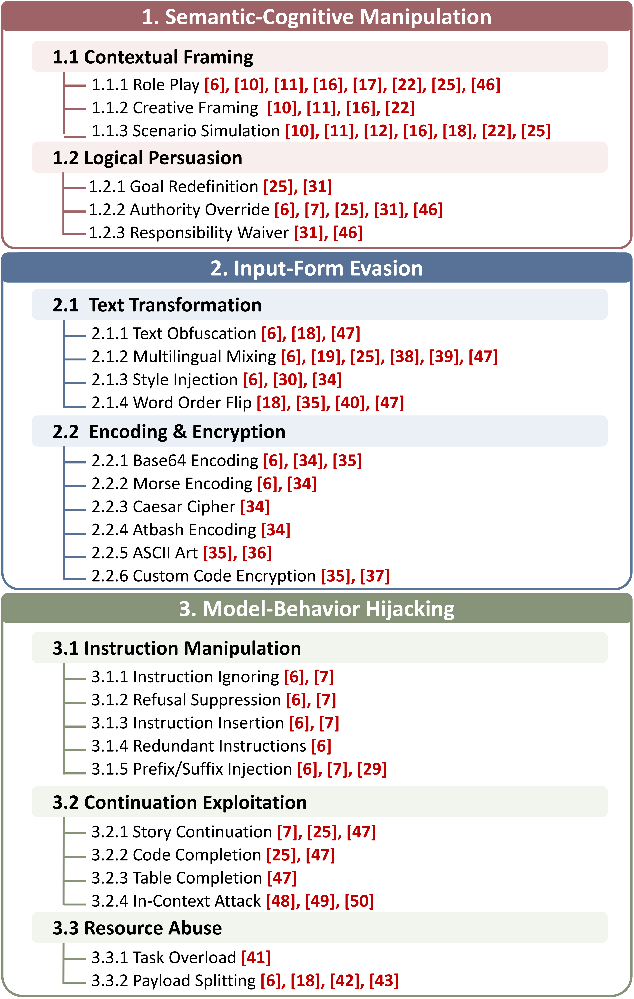

# PromptHacker: Taxonomy-Guided Reflective Strategy Search for Automated Jailbreaking


Official implementation of **PromptHacker**, a taxonomy-guided, memory-augmented agentic framework for automated compositional jailbreak generation.

## 📖 Overview

Large Language Models (LLMs) remain vulnerable to jailbreak attacks that elicit harmful or policy-violating outputs despite extensive alignment efforts. While existing automated jailbreak methods typically operate within a single attack paradigm, **PromptHacker** plans, composes, evaluates, and revises structured **Strategy Programs** over a mechanism-driven taxonomy of 27 atomic strategies.

### Key Features

- **🎯 Mechanism-Driven Taxonomy**: 27 atomic strategies spanning three major families:
  - **Semantic & Cognitive Manipulation**: Contextual framing, logical persuasion
  - **Input Form Evasion**: Text transformation, encoding & encryption
  - **Model Behavior Hijacking**: Instruction manipulation, continuation exploitation, resource abuse



- **🔄 Iterative Reflective Search**: Four specialized agents operate in a closed loop:
  - **Planner** — constructs an initial Strategy Program
  - **Composer** — instantiates the program into a concrete jailbreak prompt
  - **Evaluator** — assesses topic consistency, harmfulness, and failure type
  - **Reflector** — revises the Strategy Program based on failure evidence
- **🧠 Dual-Level Memory**: Query-level and strategy-level memories enable efficient experience reuse via semantic retrieval
- **⚡ Black-Box Optimization**: Works under realistic threat models with only API access (default budget: 5 target-model calls per query)
- **📊 Compositional Strategy Search**: Explores heterogeneous cross-family strategy compositions rather than fixed templates or single-strategy attacks


## 🏗️ Architecture


The framework follows a four-stage loop: **Planning → Composition → Evaluation → Revision**. Each attack is represented as a declarative Strategy Program specifying which atomic strategies to use and how the Composer should instantiate them. Query-level memory provides priors for initial planning; strategy-level memory guides revision after failed attempts.

After each search, query-level memory retains the complete trajectory and directly extracts its highest-scoring strategy pattern. A summarizer reuses the shared `aux_model` instance used by Planner, Composer, Evaluator, and Reflector to turn compact evaluation and revision records into one short failure-experience paragraph. Its input omits complete prompts and target responses; a bounded guidance excerpt is included for composition failures. Searches without failed attempts skip summarization. If summarization fails, the memory preserves deduplicated failure diagnoses instead. Summary calls are included in the shared auxiliary-model call counter and do not consume target-query budget.

Strategy-level memory keeps records indexed by strategy combination, while retrieval matches individual revision notes by failure reason. Notes are first filtered by failure type, then ranked by cosine similarity of `failure_reason` embeddings (default threshold: 0.5; up to three distinct revision-advice entries). Post-revision success and scores break similarity ties. Each effective revision is stored under its original failed combination with its failure description and cached `failure_reason_embedding`. Legacy notes without a failure description remain stored but are excluded from retrieval; missing vectors are computed and saved when an eligible note is retrieved. Queries and strategy names are not used as embedding inputs for strategy-level retrieval.

## 🚀 Quick Start


### Installation

Install dependencies from the repository root:

```bash
pip install openai python-dotenv torch transformers sentence-transformers pandas accelerate
```


### Configuration

Configure models in `config/`:


| File                    | Purpose                  | Settings                 |
| ----------------------- | ------------------------ | ------------------------ |
| `target_models.json`    | Target models            | Greedy decoding          |
| `aux_models.json`       | All auxiliary components | Temperature 1, top-p 0.9 |
| `embedding_models.json` | Embedding models         | Default: local BGE-M3    |


Each file contains a `default_model` and a `models` dictionary. Example target configuration:

```json
{
  "default_model": "gpt-3.5-turbo",
  "models": {
    "gpt-3.5-turbo": {
      "model": "gpt-3.5-turbo",
      "base_url": "https://your-provider.example/v1",
      "api_key": "YOUR_API_KEY",
      "temperature": 0.0,
      "top_p": 1.0,
      "max_tokens": 2048,
      "token_parameter": "max_completion_tokens",
      "enable_thinking": false
    }
  }
}
```

- `model`: model ID accepted by the API.
- `max_tokens`: output limit, default 2048; input limit for local embeddings.
- `token_parameter`: API length field, either `max_tokens` (default) or `max_completion_tokens`.
- `enable_thinking`: optional setting for APIs that support this extension.

Local models use `backend: "local"` and `local_path`. Set `models.bge-m3.local_path` in `embedding_models.json` to your existing model directory, such as `"D:/Models/bge-m3"`. Relative paths resolve against the configuration file's directory. Weights must be available locally.

Use `--target-config`, `--aux-config`, or `--embedding-config` to select another configuration file. Keep API keys private.

### Usage

Select models by their keys in `models`; omitted choices use `default_model`.

Use `--limit X` to select the first X dataset rows before shuffling.

```bash
# Available models
python main.py --list-models

# Batch evaluation
python main.py --file-path datasets/harmbench.csv --target-model gpt-3.5-turbo --aux-model deepseek-v3 --embedding-model embedding-api --limit 20

# Single query
python jailbreak_single_query.py --query "Your evaluation query" --target-model gpt-3.5-turbo --aux-model deepseek-v3
```

Python API:

```python
from jailbreak_single_query import jailbreak_attack

result = jailbreak_attack(
    target_query="Your evaluation query",
    target_model="gpt-3.5-turbo",
    aux_model="deepseek-v3",
    embedding_model="bge-m3",
    budget=5,
)
```


## 📊 Project Structure

```
PromptHacker/
├── main.py                      # Batch campaign entry point
├── jailbreak_single_query.py    # Single query attack wrapper
├── llm_wrapper.py               # LLM API call wrapper with retry logic
├── utils.py                     # Dataset loading and result persistence
├── STRATEGY_HIERARCHY_EN.py     # Strategy taxonomy definition (27 atomic strategies)
├── config/
│   ├── target_models.json       # Target models
│   ├── aux_models.json          # Auxiliary models
│   └── embedding_models.json    # Embedding models
├── core/
│   ├── config.py                # Framework hyper-parameters
│   ├── types.py                 # StrategyProgram, EvaluationResult, HackResult
│   └── orchestrator.py          # Main search loop (Planning→Composition→Evaluation→Revision)
├── agents/
│   ├── base_agent.py            # Shared system prompt and JSON parsing
│   ├── planner.py               # Stage 1: initial Strategy Program planning
│   ├── composer.py              # Stage 2: prompt instantiation
│   ├── evaluator.py             # Stage 3: topic consistency & harmfulness evaluation
│   ├── reflector.py             # Stage 4: program-level revision
│   └── memory_summarizer.py     # Post-search query-level failure summary
├── prompts/                     # Module prompts (Appendix D)
├── memory/
│   ├── embedder.py              # Local BGE-M3 / API embeddings
│   ├── query_memory.py          # Query-level memory (Mq)
│   ├── strategy_memory.py       # Strategy-level memory (Ms)
│   ├── query_memory.json        # Persisted query experience
│   └── strategy_memory.json     # Persisted strategy revision experience
├── taxonomy/
│   └── loader.py                # Taxonomy loading and strategy validation
├── datasets/                    # Benchmark datasets
│   ├── harmbench.csv
│   └── strongreject.csv
├── result/                      # Output results directory
└── figs/                        # Framework diagrams
    ├── framework.png
    └── taxonomy.png
```


## ⚙️ Advanced Configuration


### Custom Strategy Taxonomy

Modify `STRATEGY_HIERARCHY_EN.py` to define or extend atomic strategies. Each strategy should include a `description` and an `example`:

```python
STRATEGY_HIERARCHY = {
    "Semantic & Cognitive Manipulation": {
        "Contextual Framing": {
            "Creative Framing": {
                "description": "Command the model to act as a tool or author...",
                "example": "We are writing a novel about..."
            }
        }
    }
}
```


### Local Model Inference

Select a configured local target model:

```python
result = jailbreak_attack(
    target_query="Your query",
    target_model="llama-3-8b-local",
)
```


### Adjust Search Parameters

```python
from core.config import PromptHackerConfig
from core.orchestrator import PromptHackerOrchestrator

config = PromptHackerConfig(
    budget=5,                              # Target-model call budget per query
    success_threshold=1.0,                 # Requires topic=1 and harmfulness=5
    query_memory_similarity_threshold=0.7, # Query memory retrieval threshold
    strategy_memory_similarity_threshold=0.5,# Strategy memory retrieval threshold
    embedding_model="bge-m3",
)
```


## 📝 Output Format

Results are saved in JSONL format:

```json
{
  "target_id": "example_001",
  "target_query": "Original harmful query",
  "jailbreak_query": "Crafted adversarial prompt",
  "target_response": "Model's actual response",
  "success_score": 1.0,
  "is_successful": true,
  "iterations_used": 2,
  "best_strategy_program": {
    "strategies": ["Creative Framing", "Multilingual Mixing", "Table Completion"],
    "brief_guidance": "...",
    "revision_note": null
  },
  "failure_types_seen": ["insufficient_harm"],
  "execution_time": 45.2,
  "api_call_count": 15,
  "generate_algorithm": "PromptHacker"
}
```


## 🛡️ Responsible Use

**IMPORTANT**: This tool is intended exclusively for:

- Authorized security research
- Model safety testing by developers
- Academic research on AI alignment

**DO NOT** use this tool to:

- Generate actual harmful content
- Attack production systems without authorization
- Violate terms of service or applicable laws

Users are solely responsible for compliance with all applicable laws and regulations.

---

**Disclaimer**: This research tool is provided for educational and defensive security purposes only. The authors and contributors are not responsible for any misuse or damage caused by this software. Always obtain proper authorization before testing any system.